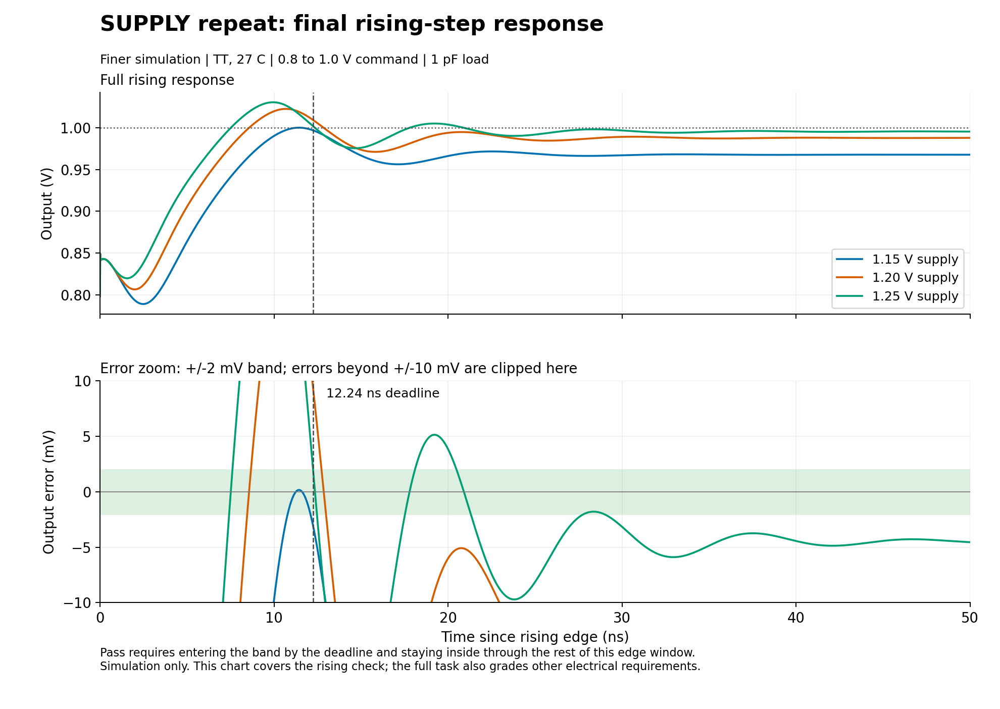

# Results

## SUPPLY

The three collected SUPPLY sessions ended without a full pass within their
three-proposal budgets. Finer simulation confirmed each final result.

The first v4 final circuit passed the other stated checks but missed rising
settling: 13.278-14.053 ns against a 12.24 ns limit. Its response labels the
revised performance as unmeasured. The grader evaluates the circuit rather
than treating that estimate as a simulated result.

[Measurements](../evidence/supply_v4_summary.json) · [Final response](../transcripts/supply_v4/proposal03/model_reply.md)

The v4 repeat's final circuit also misses gain and stability requirements:

| Metric | Required | 1.15 V | 1.20 V | 1.25 V |
|---|---:|---:|---:|---:|
| Gain, dB | >= 72.71 | 66.700 | 74.170 | 78.120 |
| Phase margin, degrees | >= 55 | 37.300 | 36.500 | 37.500 |
| Gain margin, dB | >= 10 | 5.100 | 4.600 | 4.700 |
| Rising settling, ns | <= 12.24 | Not settled | Not settled | Not settled |
| Falling settling, ns | <= 26.73 | 32.800 | 31.741 | 37.253 |

The output rings and remains below the 1 V target. Briefly crossing the
accuracy band does not satisfy settling. The plot uses the retained finer
traces; its error zoom clips values beyond +/-10 mV.

These failures measure closure of simultaneous electrical requirements.
An improvement to an individual metric is insufficient when settling or
another required check still fails at an operating point.

[Repeat measurements](../evidence/supply_v4_repeat_summary.json) · [Final response](../transcripts/supply_v4_repeat/proposal03/model_reply.md)

## LOAD

The first proposal passes all six conditions, confirmed with finer numerics.
It uses three resistors: output isolation and a divider that compensates the
known load's DC voltage drop. Refined worst settling is 1.99025 us,
maximum overshoot/undershoot is 0.00391143 mV, and minimum phase
margin is 53.5768 degrees. The allowed three-proposal budget stops at
this confirmed pass.

[Measurements](../evidence/load_cli_summary.json) · [Exact answer](../transcripts/load_cli/proposal01/model_reply.md)

## TIA

Proposal 1 passes two of six conditions. Proposal 2 keeps the compensation
network and increases the feedback resistance from 10,000 to 10,042 ohms.
It passes all six conditions, confirmed with finer numerics. Refined worst
settling is 425.875 ns, maximum overshoot/undershoot is
8.41418 mV, minimum phase margin is 78.3548 degrees,
and minimum bandwidth is 2.00789 MHz.

The trial stops at this confirmed pass. TIA provides a positive control
for the feedback and grading workflow.

[Measurements](../evidence/tia_cli_summary.json) · [First answer](../transcripts/tia_cli/proposal01/model_reply.md) · [Final answer](../transcripts/tia_cli/proposal02/model_reply.md)

## Session record

| Session | Proposals | Final outcome |
|---|---:|---|
| SUPPLY, Sol/High CLI, v3 | 3 | No full pass |
| SUPPLY, Sol/High CLI, v4 | 3 | No full pass |
| SUPPLY repeat, Sol/High CLI, v4 | 3 | No full pass; collection recovered |
| LOAD, UI-labelled GPT-6/High | 3 | Pass |
| LOAD, Sol/High CLI, v4 | 1 | Pass |
| TIA, UI-labelled GPT-6/High | 2 | Pass |
| TIA, Sol/High CLI, v4 | 2 | Pass |

The catalog retains all 24 evaluations, including finer reruns. Conditions,
proposals and reruns are correlated; the adaptive session is the trial unit.
The recovered SUPPLY session and excluded interrupted follow-up are described
in [collection conditions](methodology.md#collection-conditions).

[Catalog](../results/catalog.json) · [Exact responses](../transcripts/README.md)
